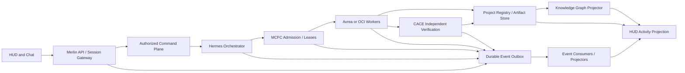

# Merlin production integration and streaming architecture v1

Status: engineering plan derived from repository inspection on 2026-11-11
Scope: connect existing HUD, chat, council, Hermes, MCFC, Avrea, CACE, project registry, knowledge graph, durable outbox, research and artifact systems. This is a plan and contract proposal, not a claim that every connection is already deployed.

## 1. Readiness conclusion

Merlin is not production-complete. The repository already contains substantial subsystems and a neural HUD, but the user-facing experience is not yet a faithful live view of the whole runtime.

Observed implementation facts:
- `ui/merlin-hud/index.html` is the primary HUD, with a neural research canvas, workspace tabs, capability status, a chat composer and a council view.
- `python/merlin/app.py` serves `/hud`, exposes `/api/chat`, `/api/council/prepare`, `/api/council/run`, telemetry and simulation endpoints.
- The HUD's composer currently calls `/api/council/prepare`; it does not call `/api/chat` or `/api/council/run`.
- The HUD script starts a synthetic demo loop. The demo is useful as a clearly labelled fallback, but it must never be presented as live runtime telemetry.
- `run_local_council` now runs up to six independent local model calls concurrently, isolates per-seat failures, optionally runs a second round, and persists seat-completion telemetry. The HTTP council response still returns a completed transcript; per-token/per-seat live browser streaming remains a follow-on.
- `/api/chat` can pass through upstream SSE, but its current synchronous HTTP implementation reads chunks in 8192-byte blocks and is not a bounded, async, high-concurrency gateway.
- `docs/merlin/MERLIN_HUD_RUNTIME_INTEGRATION_V1.md` documents canonical registry, graph and outbox injection, a bounded HUD event pump and existing service event producers.
- `python/merlin/event_outbox.py` provides durable enqueue, idempotency, leases, acknowledgement, retry, quarantine and recovery primitives.
- The existing HUD runtime is read-only. It must remain read-only with respect to privileged dispatch and verification authority.

Consequently the first task is integration and honest status, not a replacement HUD or a new event bus.

## 2. Reframe the problem

Do not connect every subsystem directly to every other subsystem. That creates an N-by-N mesh: every new module requires many new adapters, and failures cascade across unrelated modules.

Use the analogy of a distributed research institution:
- **Event bus / outbox = postal and message-routing service.** Services publish typed notices and subscribe to the notices they need.
- **Command plane = signed work orders.** A request to execute work is not a telemetry event. It has an owner, authorization, idempotency key, deadline, lease and result.
- **Project registry = records office.** It owns durable project and artifact identity, versions, content digests and provenance.
- **Knowledge graph = index and map.** It links entities and evidence; it does not become the authority for the underlying artifact.
- **CACE = independent examiner.** It checks the exact artifact digest and returns a typed verification receipt. A green HUD indicator is only a projection of that receipt.
- **HUD = control-room window.** It observes the canonical system and submits explicit user intents; it is not a scheduler, worker, registry or verifier.

This translates the coupling problem into three controlled planes: event/telemetry, command/execution, and artifact/evidence.

## 3. Ranked implementation sequence

### P0 — Make the existing HUD honest and useful

1. Remove unconditional `startDemo()` as the default when live APIs are reachable. Use an explicit connection state: LIVE, DEMO, DEGRADED or OFFLINE.
2. Keep demo mode available only as a user-visible preview with a persistent DEMO watermark. Demo events must never be mixed with real event counts, resource measurements or verification.
3. Poll or stream canonical HUD activity, graph and capability endpoints. Display endpoint health, last successful update and staleness.
4. The HUD composer now uses `/api/chat` for streamed single-model responses and has a separate Council action that calls `/api/council/run`. The council UI renders completed seat responses and failures. Change chat submit to preserve the explicit interaction modes:
   - Ask Merlin: `/api/chat` streamed answer.
   - Convene council: `/api/council/run` streamed multi-role transcript.
   - Prepare prompts: retain `/api/council/prepare` as a distinct, non-inference action.
5. Keep a durable conversation/session ID and render assistant deltas, council role cards, errors, cancellation and partial completion.
6. Keep the existing research canvas, graph, workspaces and capability registry; do not rebuild them before connecting them to canonical data.

Acceptance:
- The chat client reads the `/api/chat` SSE stream and renders incremental response deltas. Browser-level integration tests and a live qualified provider check remain required.
- Council preparation is never described as a council response.
- No synthetic event can create a runtime-active agent, measured resource metric or verified state.
- A missing canonical store produces a clearly labelled unavailable/degraded state, not fake live telemetry.

### P1 — Standardize the canonical event contract

Adopt one versioned envelope, compatible with existing `merlin-telemetry/1` where possible:

```json
{
  "schema": "merlin-event/1",
  "event_id": "evt_<deterministic-id>",
  "correlation_id": "request-or-workflow-id",
  "causation_id": "parent-event-id-or-null",
  "occurred_at": "RFC3339 UTC timestamp",
  "producer": {"service": "hermes", "instance": "worker-01"},
  "subject": {"project_id": "project-id", "artifact_id": null, "task_id": "task-id"},
  "type": "task.progress",
  "version": 1,
  "classification": "internal",
  "payload": {},
  "provenance": {"source_commit": null, "artifact_sha256": null}
}
```

Required rules:
- Validate schema and size at ingress; reject unknown incompatible major versions.
- Stable event IDs and idempotent consumers.
- Correlation and causation IDs preserve workflow lineage.
- UTC timestamps, producer identity and typed subject references.
- Never put secrets, full credentials, private raw prompts or unbounded binary payloads in event envelopes.
- Large files travel through artifact storage; events carry immutable digest references.
- Events are observations, not authorization. A `task.requested` event alone never dispatches a runner.
- Keep the current SQLite outbox as the first durable transport; do not introduce Kafka, Redis Streams or NATS until measured throughput or multi-host availability proves SQLite insufficient.

### P2 — Connect all services through adapters, not direct dependencies

Canonical flow:



Producer/subscriber responsibilities:
- HUD/API: publish user intent, session lifecycle and user-visible stream status.
- Hermes: publish decomposition, assignment, queued, started, progress, blocked, completed and failed states.
- MCFC: publish admission decisions, lease creation/renewal/expiry, reserved budget and separately measured consumption.
- Avrea/OCI: publish runner accepted, started, heartbeat, exit status, logs/artifact references and observed metrics.
- Registry: publish project/artifact created, versioned, committed and content-addressed events.
- Knowledge graph: consume registry and verified evidence events; update typed nodes and explicit edges.
- CACE: publish verification requested, running, passed, failed, unavailable and receipt stored; include verifier identity/version, exact artifact digest and receipt digest.
- HUD projector: consume events idempotently and derive views; it never authorizes work.

Every adapter must be independently replaceable. A failed graph projection must not delete the source artifact or block the worker's result; it should retry or quarantine the projection.

### P3 — Split streaming into three different channels

Do not treat every stream as the same thing.

1. **Inference stream (low latency):** SSE from model/provider to session gateway to browser. Send text deltas, role labels, tool status and terminal usage/error events. Support cancellation, deadlines, heartbeat and partial output.
2. **Workflow event stream (durable):** outbox-backed events from Hermes, MCFC, Avrea/OCI, registry and CACE. Deliver at least once; consumers are idempotent. SSE/WebSocket is a read-only delivery projection for the HUD, not the durable source.
3. **Artifact/data stream (large payload):** upload/download through registry/object storage with content hash, size, media type, source commit and access classification. Event messages refer to artifacts by ID and digest, never inline large data.

Recommended browser transport:
- Start with SSE for server-to-browser updates because the UI primarily observes events. Use a POST for user commands and a session-scoped SSE GET for the response/events.
- Add WebSocket only if real bidirectional low-latency interaction (voice duplex, shared cursors or collaborative editing) is demonstrated to require it.
- Use `Last-Event-ID` or an explicit cursor for reconnect and replay. Send periodic heartbeats. Bound replay windows and show when the client has fallen behind.
- Keep inference tokens ephemeral; persist completed/partial assistant messages and provenance according to session policy. Do not place every token into the global research graph.

### P4 — Stream a real council

1. Keep the six existing persona definitions and independent opening-prompt boundary.
2. Run eligible seats concurrently with a bounded worker pool, per-seat deadlines and cancellation. The first implementation now bounds concurrency at six and isolates failures; provider-level deadlines and cancellation propagation remain to be completed.
3. The current implementation persists per-seat completion/failure telemetry during execution. Next, expose those events over SSE and add token deltas: `council.started`, `seat.started`, `seat.delta`, `seat.completed`, `seat.failed`, `cross_exam.started`, `cross_exam.completed`, `council.synthesis`, `council.completed`.
4. The chair/synthesizer must distinguish agreement, disagreement, unknowns, assumptions and evidence. It cannot turn vote count into truth.
5. Keep separate roles for architect, builder, skeptic, empiricist, mathematician and other configured personas; role diversity is a prompt configuration, not six independent people.
6. A simulated council mode may generate scripted illustrative content only if clearly marked SIMULATED. Never label canned output as model inference.
7. Record model/provider/revision and response digests, but redact secrets and avoid logging raw sensitive prompts by default.

### P5 — Make the command plane explicit and safe

Use a command state machine:
`draft -> validated -> awaiting_approval -> authorized -> leased -> running -> result_collected -> verification_pending -> verified | rejected | failed | expired`.

Each command requires:
- command ID and idempotency key;
- actor and authorization decision;
- project/task/artifact scope;
- capability policy and registry contract hashes;
- resource budget and deadline;
- preview/diff and approval receipt when required;
- lease owner, expiry, heartbeat and cancellation semantics;
- immutable result and artifact digests;
- independent CACE receipt for claims that require proof.

No HUD click directly invokes Avrea. The HUD submits an intent; the command plane checks policy; Hermes schedules; MCFC admits; an approved runner executes; registry stores outputs; CACE verifies the exact artifact; HUD reflects observed states.

### P6 — Build a unified capability and health registry

Each capability must expose:
- `configured`, `available`, `qualified`, `degraded` and `unavailable` as distinct states;
- provider/adapter and revision;
- accepted input/output schema;
- resource limits, timeout and cancellation support;
- qualification receipt and last health-check time;
- permitted data classifications;
- owner and dependent capabilities.

Do not infer a capability from a file being present or a service name existing. A capability becomes qualified only after an actual held-out test and a recorded receipt.

### P7 — Production reliability and observability

- Async inference gateway with connection pooling, bounded concurrency, request deadlines, cancellation propagation and per-provider circuit breakers.
- Outbox retention, retry backoff, quarantine inspection and replay tooling.
- Worker leases, idempotent result collection and duplicate execution protection.
- Structured metrics: TTFT, tokens/sec, queue latency, job duration, retry count, lease expiry, event lag, artifact bytes, cost and verified-result rate.
- Trace one correlation ID across API, council, Hermes, MCFC, runner, registry and CACE.
- Health/readiness/liveness endpoints that distinguish local API availability from subsystem qualification.
- Authentication and authorization before any non-loopback exposure; TLS, CSRF protections where applicable, rate limits, audit log and data-classification enforcement.
- Backup/restore drills for registry, graph, outbox and conversation state.

### P8 — Release and deployment

- Keep the loopback-only development server as local mode.
- Define a production deployment profile with authenticated ingress, secret manager, persistent volumes or managed durable database, backups, worker isolation and resource budgets.
- Keep OCI/Avrea runner integrations opt-in until a real connection and job receipt are observed.
- Pin dependencies, build reproducibly, run security checks and complete the entire test suite.
- Publish a release manifest with commit SHA, build digest, migration version, capability qualification receipts and rollback target.
- Do not call Merlin production-ready until the acceptance gates below pass.

## 4. Inductive and deductive engineering method

Every iteration uses two directions and reconciles them.

### Induction: derive requirements from observations
1. Inspect real source, API behavior, logs, event samples, runner receipts and user workflows.
2. Record observed facts separately from assumptions and desired behavior.
3. Measure latency, event loss/duplication, retry behavior, state freshness, resource use and failure modes.
4. Group recurring failures into system requirements.
5. Update the interface contracts and tests only when evidence supports the change.

### Deduction: derive tests and implementation from requirements
1. Start from invariants: authority never expands; artifact identity is content-addressed; verification binds exact bytes; outbox delivery is idempotent; demo is never live.
2. Derive preconditions, state transitions, error cases and acceptance tests.
3. Implement the smallest adapter or vertical slice.
4. Test with deterministic fakes, then a real local integration, then a real qualified runner/provider.
5. Compare observed behavior to the predicted behavior and update the model.

### Reconciliation record per change
Each implementation task should include:
- observed requirement and source;
- architectural hypothesis;
- smallest patch;
- tests and expected observations;
- actual result, logs and receipts;
- discrepancy and revised requirement;
- next ranked action.

When blocked, translate the problem to a structurally equivalent domain. Example: if the event bus is unavailable, do not make every service call every other service. Use the same postal-service analogy: define the envelope, durable local mailbox and acknowledgement protocol first; later swap the transport while preserving the contract. If an OCI runner is unavailable, preserve a signed/typed job package and result contract, run deterministic local contract tests, and leave remote execution explicitly unqualified.

## 5. Production acceptance gates

| Gate | Required evidence |
|---|---|
| HUD truthfulness | No demo/live conflation; health and freshness visible |
| Chat | Real streamed model response; cancellation and partial response tested |
| Council | At least three independent seats stream concurrently; role failures isolated; synthesis separates disagreement and evidence |
| Event delivery | Outbox replay, duplicate delivery, retry, quarantine and consumer idempotency tests pass |
| Hermes | Actual worker lifecycle observed from accepted task through terminal state |
| MCFC | Admission, lease, budget reservation and measured consumption distinguished |
| Avrea/OCI | Real runner job ID, heartbeat, exit status, collected artifacts and source commit bound in receipt |
| Registry | Artifact digest and version survive restart and backup/restore |
| Knowledge graph | Projected links reconcile to canonical registry/evidence and can be rebuilt |
| CACE | Independent receipt binds source commit, exact artifact digest, verifier revision and result |
| Security | Authenticated ingress, scoped commands, secret redaction, cancellation and audit tested |
| Release | Full CI, migration test, deployment smoke test, rollback rehearsal and release manifest |

A green UI indicator is not a release gate. The underlying signed/typed evidence and test result are.

## 6. Immediate next vertical slice

Implement one end-to-end user-visible workflow before adding more modules:

1. User enters a request in the HUD.
2. Session gateway creates a conversation and correlation ID.
3. HUD streams the lead answer and council seat events as they arrive.
4. If work is requested, Hermes creates a task only after authorization.
5. MCFC validates a bounded lease.
6. Approved Avrea/OCI worker executes and emits heartbeat/progress.
7. Registry stores the artifact and immutable digest.
8. CACE verifies the exact artifact when required.
9. Knowledge graph consumes the artifact and receipt references.
10. HUD shows the timeline, active agents, artifacts, evidence and final result from canonical read models.

The first release may use a local qualified model and local worker for the vertical slice. Missing provider/runner configuration must be shown as unavailable, not filled with invented data. The architecture remains provider- and runner-neutral.

## 7. Explicit non-goals for this increment

- Do not replace the existing HUD, council personas, outbox, registry or knowledge graph.
- Do not add Kafka, Redis, NATS or another paid service without measured need.
- Do not automatically dispatch remote jobs from chat or telemetry.
- Do not claim simulated council personas are independent humans or sentient agents.
- Do not claim CACE proof, CAD safety, scientific validity or production qualification from a UI visualization.
- Do not merge or deploy this planning change automatically.
