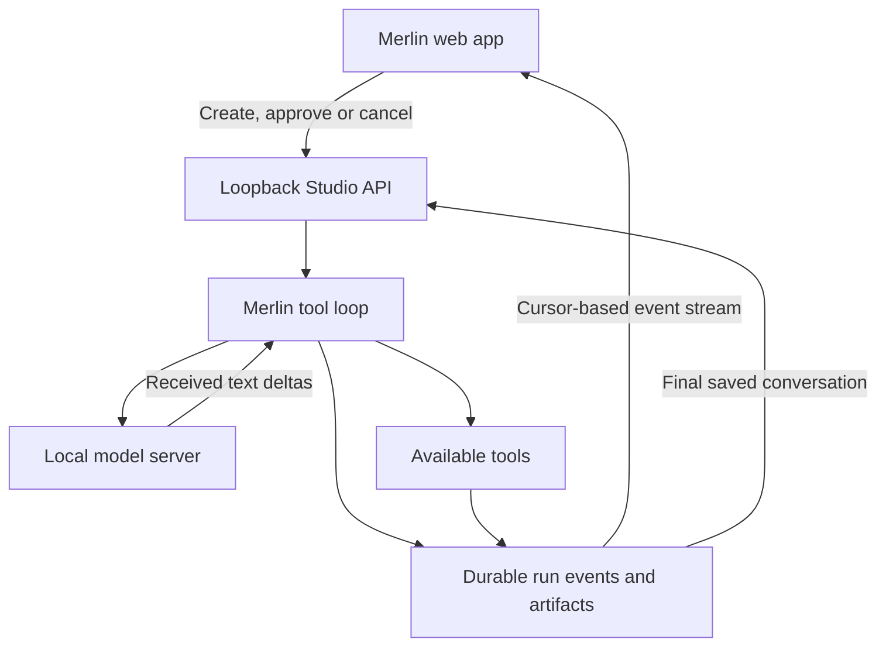

# Merlin Studio: independent streaming workspace

## Decision

Use Merlin's existing local Studio as the primary application. Serve its web UI
from the same loopback Python process that owns the durable run history, and
connect it to a local inference server through the chat-completions protocol.
This requires no ChatGPT session, OpenAI account, Claude subscription, or Grok
subscription. A compatible protocol is a transport format, not a provider
dependency.

The interface borrows useful interaction patterns—conversation navigation,
streamed responses, workspace files, visible tool activity, and restrained
typography—while retaining Merlin's own name and identity. It does not include
proprietary product code, branding assets, or closed model weights. Similar UI
features do not establish equivalent model capability.

## Ranked architecture choices

| Rank | Architecture | Decision and trade-off |
| --- | --- | --- |
| 1 | Merlin Studio, existing registry and tool loop, local model, durable event stream | Implemented in this candidate. Preserves existing conversations, approvals, artifacts, Second Brain and offline packaging; adds no web framework or hosted account dependency. |
| 2 | Open WebUI as an additional frontend to a Merlin service adapter | Useful if its document and multimodal interface is needed. It would require a separately qualified adapter for Merlin's tool approvals, artifacts and restart semantics, plus another application stack. Not substituted for the current working Studio. |
| 3 | A full OpenBot-based replacement application | The pinned MIT `pmwasim/OpenBot` is useful as an optional companion with named bots and durable tasks. Replacing Studio would create two competing stores and execution authorities unless those contracts were deliberately reconciled. The existing separate companion remains available. |

These ranks are engineering judgments for this repository, not benchmark scores.
They prioritize continuity of state, complete offline distribution, low setup
cost, and a small dependency surface.

## Implemented data flow

The browser receives response text and structured events directly from Merlin.
It does not receive a streamed ChatGPT webpage or depend on a remote desktop
session. A separate GPU host could serve inference later through an explicitly
configured and qualified gateway. The current Studio keeps its loopback-only
boundary; this change does not silently expose it on a LAN.

### Genuine response streaming

`LocalModel.stream()` requests upstream `stream: true` and emits text while
complete SSE frames arrive. The incremental parser handles byte fragmentation,
UTF-8, comments, CRLF, and function-call fragments. It bounds bytes, frames,
content, and tool arguments. No tool is executed from a partial JSON fragment.
JSON-only providers remain usable as whole responses; those responses do not
create fabricated text deltas.

The UI subscribes to
`GET /api/runs/{run_id}/events?after={ordinal}` with the current launch's
`X-Merlin-Token` header. Event UUIDs retain their durable identity; database
ordinals are reconnect cursors. Approval and terminal snapshots request a fresh
authoritative run/conversation read. Reconnection does not resubmit a prompt.

The server bounds each subscription to a 30-second processing window and 2 MiB
of response body, including comments, snapshots, and heartbeats. At most 16
subscriptions run concurrently. Cancellation closes a blocked upstream model
socket and records the stopped run. Already completed external side effects
are not undone by cancellation.

### Visual identity and measured animations

The `MERLIN` ASCII word is assembled from six five-row glyphs. Each next letter
begins one row lower, producing the requested descent to the right. A two-sided
coin animation rotates through quarter turns when an unseen `started` or
`model_request` event arrives. Replayed event IDs do not repeatedly trigger the
same invocation. Loading a saved conversation does not animate all its past
calls. Reduced-motion preferences suppress the spin.

The activity view counts actual model requests, completed tool results, received
UTF-8 text bytes, and recorded events. Its chart maps recorded timestamps to
cumulative received text bytes; it never labels those bytes as model tokens.
Long traces are sampled to at most 128 displayed vertices while preserving the
first and final cumulative values. An idle or tool-only run has no fabricated
model-output line. GPU usage and memory figures are absent unless a future
measured telemetry provider supplies them.

Final replies use a local, DOM-based Markdown subset for headings, emphasis,
lists, tables, quotes, code, and HTTP(S) links. Model text is never inserted as
HTML. Links with active schemes or embedded credentials are rendered as text.
The UI retains a stopped response as a visibly partial event-backed draft.

## Capability status

| Capability | Current implementation | Qualification boundary |
| --- | --- | --- |
| Local chat and streaming | Merlin UI, loopback API, local model adapter | Actual model behavior depends on the selected model and template. |
| Saved conversations and files | Existing SQLite/registry and workspace tools | Local trusted-user application. |
| Tool activity and cancellation | Durable events, streamed view, bounded tool loop | Code and desktop actions retain their existing approvals and provider requirements. |
| Second Brain | Existing Obsidian-compatible review panel | Vault must be configured; opening notes does not automatically train the model. |
| Public source retrieval | Existing public HTTPS transport | Requires network availability and enabled settings. |
| Interactive browser or desktop | Existing optional adapters | Their required host services must be installed and independently qualified. |
| OpenBot | Pinned optional local companion and launcher | Separate state/permissions; not automatically started or included in the base Studio runtime. |
| Image, voice, video and CAD models | No new model provider in this change | An attractive UI does not supply these inference capabilities. |
| SSD plus Parallax | Separate actual-model recovery/qualification lane | Does not turn SSD storage into GPU compute. |

## Verification and evidence scope

Before combined publication, the backend owner ran 119 passing cases across
eight focused and existing suites. These use actual loopback TCP with explicitly
synthetic model output. They establish transport and control behavior, including
text-before-finish, cancellation, restart/replay, tool-fragment rejection, and
strict byte windows; they do not establish learned-model quality.

The frontend contract executes the actual renderer and event-state functions
under Node. It covers structured formatting, literal HTML handling, link policy,
literal fenced code, cursor deduplication, and partial-draft lifecycle. Browser
QA uses the actual UI with a clearly labeled replay of an observed Merlin run.
The first recorded run reads a real workspace copy of the public Studio guide;
it performs no model inference. A separate build recorder obtains actual model
deltas from the extracted offline package after the original native answer gate.

The final CI run IDs, downloadable artifact digests, and learned-model trace
results belong in the appended verification update after those runs complete.
Successful transport tests or a recorded replay must not be relabeled as broad
model quality or deployment qualification.

## Source references

- Existing implementation baseline: `Mannyspiro/expert-robot` commit
  `2d471294bc73f4b90e2e87e7aa8ea2e932443e56`.
- [Pinned OpenBot README](https://github.com/pmwasim/OpenBot/blob/019b4c65f488af06ce1a1cfb741cd825129a4c1a/README.md)
  and the repository's `config/merlin/third-party-sources.json`. Read coverage:
  complete pinned README and existing Merlin launcher/fixture smoke. This does
  not imply a fresh audit of all OpenBot source.
- [Pinned llama.cpp server](https://github.com/ggml-org/llama.cpp/tree/44d50873b56b568c28ef2ad8d6445069feaa9fbd/tools/server).
  The native package builds this exact engine source.
- [Open WebUI provider connections](https://docs.openwebui.com/getting-started/quick-start/connect-a-provider/),
  read November 24, 2026: provider endpoints determine where inference runs.

## Remaining acceptance

Complete exact-source integrated CI and the actual extracted Linux model build,
then independently verify the downloaded ZIP and bounded streaming receipt.
The phone layout can be checked in a browser viewport; that does not qualify an
Android engine, native APK, iOS installation, or phone thermal performance.
Remote multi-user hosting, additional model providers, and a unified OpenBot
task store require their own concrete contracts and acceptance work.
